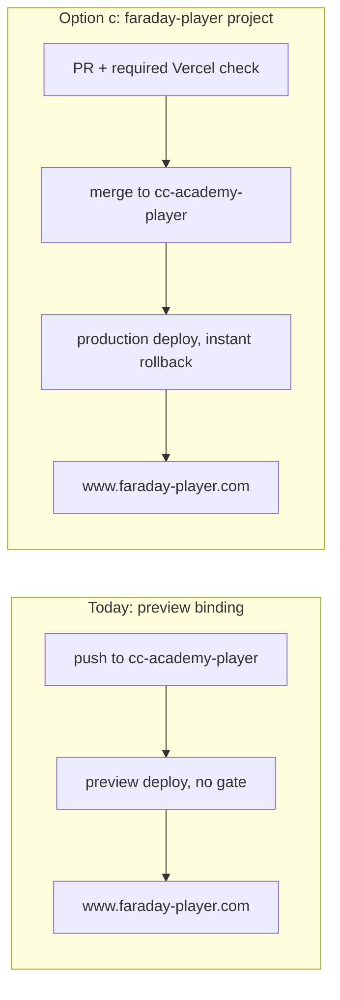

# FDY-41 — Player domain production-readiness review

**Run:** 2026-11-06 22:27 CST (Claude Code, wave-1, unattended).
**Scope:** read-only. **No settings were changed** — no Vercel domain, env var, protection,
project or cron setting; no GitHub branch protection; no push to `cc-academy-player`; no edge
function deployed. Env var **names only** were read; no value was decrypted, printed or stored.

Companion to [`player-domain-move.md`](player-domain-move.md) (the 2026-10-05 move attempt that
stopped at its gate).

## Verdict

**`www.faraday-player.com` is still NOT a production surface.** Nothing has changed since
2026-10-05: the domain is bound to the git branch `cc-academy-player` on the Daily Challenge
engine's project, and the prepared `faraday-player` project still holds only 1 of the variables
it needs. **Recommendation: option (c), a separate Vercel project — already built as
`faraday-player` — finished by Myke adding three variables and moving the domain.** Add branch
protection on `cc-academy-player` as well, because under (c) that branch *becomes* production.

## 1. Vercel findings (`v0-faraday-daily-challenge-n2u5`, `prj_A7MhvdAWivMLOccGMTp6AFYZQ1s1`)

### Domains

| Domain | Git branch binding | Redirect |
| --- | --- | --- |
| **`www.faraday-player.com`** | **`cc-academy-player`** (preview) | — |
| `faraday-player.com` | — | 308 → `www.faraday-player.com` |
| `www.faraday-intelligence.ai` | production | — |
| `faraday-intelligence.ai` | — | 308 → www |
| `www.faradaydailychallenge.com` | production | — |
| `faradaydailychallenge.com` | — | 308 → www |

### Deployment protection

Password, Vercel Authentication (SSO) and Trusted IPs are all **off** for the project. Every
`cc-academy-player` deployment is publicly reachable and goes live on the player domain on push.

### Env var names by target (project-level)

| Name | Type | Production | Preview (all) | Preview `cc-academy-player` only |
| --- | --- | :-: | :-: | :-: |
| `NEXT_PUBLIC_SUPABASE_ANON_KEY` | encrypted | | | ✓ |
| `ACADEMY_REVALIDATE_SECRET` | sensitive | | | ✓ |
| `ANTHROPIC_API_KEY` | sensitive | ✓ | ✓ | |
| `SUPABASE_URL` | sensitive | ✓ | ✓ | |
| `SUPABASE_SERVICE_ROLE_KEY` | sensitive | ✓ | ✓ | |
| `DC_PUZZLE_SOURCE` | sensitive | ✓ | ✓ | |
| `NEXT_PUBLIC_LEAGUE_OFFICE_OPEN` | sensitive | ✓ | ✓ | |
| `SIGNAL_ROOM_URL` | sensitive | ✓ | ✓ | |
| `RESEND_API_SECRET` | sensitive | ✓ | ✓ | |
| `HINT_GATE_ENFORCED` | sensitive | ✓ | ✓ | |
| `AIR_TABLE_API_KEY` | sensitive | ✓ | ✓ | |
| `AIRTABLE_API_KEY` | sensitive | ✓ | ✓ | |
| `BEEHIIV_PUB_ID` | sensitive | ✓ | ✓ | |
| `BEEHIIV_API_KEY` | sensitive | ✓ | ✓ | |
| `NEXT_PUBLIC_PREDICTS_API_URL` | encrypted | ✓ | ✓ | |
| `VITE_PREDICTS_API_URL` | encrypted | ✓ | ✓ | |

`hiddenProductionEnvCount` = 0. Team-level shared variables were not listed by this tool. They
may account for names the code reads but the project does not hold (see §2).

### Last five deployments on `cc-academy-player`

All have target **preview** (`target: null`) and state **READY**. None is a rollback candidate.

| Created (Central) | Commit | Message (first line) |
| --- | --- | --- |
| 2026-10-05 15:54 | `29c9fab` | Merge PR #185: academy-public summary + personas (FDY-39) |
| 2026-10-03 22:56 | `3a5a792` | academy-ai: 10 searches per answer… |
| 2026-10-02 17:47 | `2b621b3` | academy-ai: finalAnswer must be GuardedAnswer… |
| 2026-10-02 17:41 | `e2a0acf` | origin: a schemeless NEXT_PUBLIC_SITE_ORIGIN must not break the site |
| 2026-10-02 17:02 | `af964d7` | proxy: /api/revalidate was unreachable on the player domain |

All five went live on the public player on push, with no required review or check. `2b621b3`
fixes a type error that, by its own commit message, was pushed without re-running the build.

### State of the prepared `faraday-player` project (`prj_ECFNfXFwDg3Ym2mam5QsSnl944GD`)

Unchanged since 2026-10-05. No custom domain. SSO protection is `all_except_custom_domains`.
It holds **one** env var, `NEXT_PUBLIC_SUPABASE_ANON_KEY` (production + preview). Its latest
deployment (2026-11-06 17:37 CST) is a preview, so production still serves the 2026-10-05
build probe. The cron-disabled flag was not re-read; the companion report's warning still applies.

## 2. What the player reads, and where each value is set

The player repo (`cc-academy-player` @ `29c9fab`) has 35 distinct `process.env.*` names in
`src/`. Most belong to the Daily Challenge engine: crons, pipelines, the league and Airtable sync.
**The academy request path reads only three of them.** The Supabase URL is hard-coded in
`src/lib/supabase.ts` (`https://ycadmmngkdhvpcsrcuaq.supabase.co`), so the academy needs no
`SUPABASE_URL`.

### Academy path (what the player domain actually needs)

| Name | Read in | Set today | On `faraday-player` production? | Effect if missing |
| --- | --- | --- | --- | --- |
| `NEXT_PUBLIC_SUPABASE_ANON_KEY` | `src/app/api/academy/progress/route.ts` | old project: preview, `cc-academy-player` only | **✓ set** | signed-in progress sync fails |
| `ACADEMY_REVALIDATE_SECRET` | `src/app/api/revalidate/route.ts` | old project: preview, `cc-academy-player` only (sensitive) | **✗ missing** | status-change revalidation hook rejects every call; pages fall back to 300 s ISR |
| `NEXT_PUBLIC_SITE_ORIGIN` | `src/lib/academy/origin.ts` | **not a project-level var** on either project (commit `e2a0acf` says it was set by hand, so it may be a team var) | ✗ (not needed) | falls back to the hard-coded `https://www.faraday-player.com`, the correct value |

`NODE_ENV` and `VERCEL_ENV` are Vercel built-ins.

### Edge functions (`supabase/functions/academy-*`)

| Name | Function(s) | Set in | Affected by a domain move? |
| --- | --- | --- | --- |
| `SUPABASE_URL` | academy-public, academy-ai | Supabase built-in | No |
| `SUPABASE_SERVICE_ROLE_KEY` | academy-public, academy-ai | Supabase built-in | No |
| `ACADEMY_VALIDATE_SECRET` | academy-public, academy-ai (diagnostics) | Supabase function secret | No |

`academy-ai` also reads its Anthropic key through an `env()` helper. That key is a Supabase
secret, not a Vercel one. The Go-deeper panel calls `academy-ai` directly through
`/api/academy/deeper`, and that route reads no Vercel env var.

### Rest of `src/` (engine — reachable on the player deployment but not on the academy path)

`ACADEMY_AIRTABLE_BASE_ID`, `ACADEMY_COURSES_TABLE_ID`, `AIRTABLE_API_KEY`, `AIRTABLE_BASE_ID`,
`AIRTABLE_IDF_DOMAIN_TABLE_ID`, `AIRTABLE_IDF_SUBDOMAIN_TABLE_ID`, `AIRTABLE_TABLE_ID`,
`ANTHROPIC_API_KEY`, `BEEHIIV_API_KEY`, `BEEHIIV_PUB_ID`, `CRON_SECRET`, `DATA365_API_KEY`,
`DC_GEN_MODEL`, `DC_PUZZLE_SOURCE`, `DC_SLATE_ENFORCEMENT`, `EIA_API_KEY`, `FAR287_GEN_MODEL`,
`FARADAY_AIRTABLE_API_KEY`, `FARADAY_AIRTABLE_BASE_ID`, `FARADAY_AIRTABLE_TABLE_ID`,
`JW_CRON_SECRET`, `NEXT_PUBLIC_FARADAY_TEASERS`, `NEXT_PUBLIC_LEAGUE_OFFICE_OPEN`,
`PARTISAN_LEAN_CSV_URL`, `PIPELINE_SECRET`, `RESEND_API_KEY`, `RUCC_CSV_URL`,
`SUPABASE_SERVICE_ROLE_KEY`, `SUPABASE_URL`, `VOYAGE_API_KEY`.

Of these, only the following are project-level vars on the old project (production + preview):
`AIRTABLE_API_KEY`, `ANTHROPIC_API_KEY`, `BEEHIIV_*`, `DC_PUZZLE_SOURCE`,
`NEXT_PUBLIC_LEAGUE_OFFICE_OPEN`, `SUPABASE_SERVICE_ROLE_KEY` and `SUPABASE_URL`. Neither project
holds the others; they are either team-level or unset. Note the name mismatch: the code reads
`RESEND_API_KEY`, but the project holds `RESEND_API_SECRET`. That is an engine issue, so it is
noted here and left alone.

**Would anything go missing in production?** Under (b), the engine's production target lacks
both player vars, `NEXT_PUBLIC_SUPABASE_ANON_KEY` and `ACADEMY_REVALIDATE_SECRET`, so both would
need adding. Under (c), `faraday-player` lacks `ACADEMY_REVALIDATE_SECRET`. It would also need
`SUPABASE_URL` and `SUPABASE_SERVICE_ROLE_KEY` for the engine routes (`/api/teams`,
`/api/lo/seasons`) that measured 500 on the probe. The academy itself does not need those two.

## 3. Options evaluated

| | (a) Keep branch domain + protection | (b) Merge into engine `main`, attach to production | (c) Separate project, prod branch `cc-academy-player` |
| --- | --- | --- | --- |
| Preview-scoped env vars on a public domain | stays | fixed | fixed |
| Release gate | PR + required check only | engine's cadence | PR + check, plus production promotion |
| Instant rollback | no (branch deploys are not rollback candidates) | yes | **yes** |
| Touches faraday-intelligence.ai / Daily Challenge | no | **yes**, every player change ships with the engine | no |
| Work remaining | branch protection only | large merge across divergent branches | **3 env vars, cron check, domain move** (project exists, build verified) |
| Risk | low change, but the risk stays | high | low; the main trap (15 duplicate crons) is already disabled |

**Recommendation: (c).** The evidence supports the prompt's hypothesis. The player's last five
releases all went to a public domain with no gate and no rollback. `faraday-player` is already
built and its build passes, so (c) is now the cheapest *and* the safest option. (b) would couple
every academy push to the Daily Challenge sites. (a) fixes the gate but leaves preview semantics
and no rollback. **Do (a)'s branch protection as part of (c)**, because `cc-academy-player`
becomes a production branch.

## 4. Steps for Myke (⛔ = Hard-Stop, needs your explicit yes)

1. ⛔ **Add env vars to `faraday-player`** in the dashboard (Production and Preview):
   `ACADEMY_REVALIDATE_SECRET` (academy-critical), plus `SUPABASE_URL` and
   `SUPABASE_SERVICE_ROLE_KEY` if the engine API routes must work on the player host. For full
   parity with today's deployment, add the remaining old-project vars listed in §1. Sensitive
   values cannot be read back, so copy them from your own store or re-enter them.
2. ⛔ **Confirm crons are still disabled** on `faraday-player` (Settings → Cron Jobs) right after
   step 1. With credentials present, the 15 engine crons would run twice.
3. ⛔ **Redeploy `faraday-player` production** from `cc-academy-player` HEAD (`29c9fab` or later)
   and re-run the gate: `/academy`, three course pages, glossary, quiz, and one
   `/api/academy/deeper` request on `faraday-player.vercel.app`.
4. ⛔ **GitHub branch protection on `cc-academy-player`**: require a PR and the Vercel build
   status check. This stops a repeat of the unbuilt push that `2b621b3` had to fix.
5. ⛔ **Move the domains**: remove `www.faraday-player.com` (branch binding) and
   `faraday-player.com` from `v0-faraday-daily-challenge-n2u5`, then add both to
   `faraday-player` (www primary, apex 308 → www). Touch no other domain.
6. **Verify** `https://www.faraday-player.com/<slug>` from the lobby, then do a
   `POST /api/revalidate` dry run with the secret.
7. ⛔ **Repoint Supabase Vault `academy_revalidate_url`** to
   `https://www.faraday-player.com/api/revalidate`. Today it holds the old project's git-branch
   alias, which would keep revalidating a deployment nobody reads.
8. **Rollback:** move both domains back to the old project with the `cc-academy-player`
   branch binding.

## Checks

- No settings were changed. ✔
- Every env var name the player reads is listed in §2, with where it is set. ✔
- No env var value was read, decrypted or written. ✔
